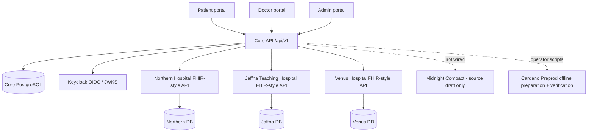

> **v0.6.0 BACKEND-FIRST SOURCE RELEASE (synthetic data only):** Complete version-controlled OpenAPI 3.1 specification for **19** implemented API routes (Swagger displays the same contract), public error envelope with `X-Request-ID`, doctor-scoped `Idempotency-Key` + Core SQL migration, FHIR retry content checks, bounded HTTP JSON body parsing, additional auth rate limits, private Hospital API documentation, and restrained **light-theme** UI polish. **100 offline tests pass. Full dependency-aware build, live DB migrations, Docker, Cardano Preprod and Midnight testnet remain unverified.** See [v0.6 release notes](docs/testing/RELEASE_NOTES_0.6.md).

> **Historical v0.5.0 SOURCE RELEASE (synthetic data only):** Added 24-hour request approval deadlines, nine Core SQL migrations, FHIR R4 AllergyIntolerance.patient correctness and bounded clinical-write validation, 4-way bounded Hospital API retrieval, patient/doctor cursor pagination, improved Merkle manifest checks, Docker per-service secret isolation and real-stack database-owner isolation QA script. **Real Docker/PostgreSQL, Cardano Preprod and Midnight integration remain UNVERIFIED.** See [v0.5 release notes](docs/testing/RELEASE_NOTES_0.5.md).

> **Historical v0.4.0 SOURCE PREVIEW:** 9 Core SQL migrations, 2 reusable Hospital SQL migrations, durable PostgreSQL-backed HMAC token replay protection, operator-pinned Hospital URLs, Cardano proof-to-record binding, cursor-pagination, paginated patient audit, API database readiness, an optional Ledger 9 prover container and real-stack E2E test *scripts*. These scripts require external Docker/Keycloak/PostgreSQL to run. Cardano on-chain submission and Midnight ZK authorization remain **UNVERIFIED/UNINTEGRATED**. See `docs/testing/RELEASE_NOTES_0.4.md`.

# LankaHealthChain

**Federated Healthcare Records · Patient Consent · Verifiable Integrity**

UniHack 2026 hackathon implementation | Apache-2.0 | **synthetic medical data only**.

> **STATUS: Runnable source-code prototype; only offline tests verified here; NOT production-ready.**
> NestJS `/api/v1` controllers, three hospital simulators, four independently managed PostgreSQL
> databases (Core + three hospital databases), versioned SQL migrations, React portals, consent flow, restricted record creation,
> Cardano Merkle tooling, worker and Ledger 9 Compact draft are included.
> Docker services, live database migrations, browser E2E, signed Cardano Preprod
> transactions, Midnight contract compilation/deployment and real ZK proofs
> are **UNVERIFIED or NOT COMPLETED** in this authoring environment.
> Synthetic patient records only; never enter real medical information.

## System architecture



Three hospital simulators are **mocked institutional integrations**, not actual
connections to the named hospitals. Their clinical resources are stored separately;
the Core stores registry, identity mappings, consent, record references, randomized
integrity commitments, and audit logs. Core never opens hospital SQL connections.


## Quick start – all local demo services (Docker)

> **Development-only**: your computer must have Docker, network package access and
> enough memory. This stack has not been run in the authoring environment.

```bash
node scripts/setup-local.mjs  # creates .env with secure random passwords; once only
docker compose --env-file .env \
  -f infrastructure/docker/compose.yml \
  -f infrastructure/docker/compose.app.yml up -d --build
```

On a compatible developer machine, this Compose configuration is intended to initialize four PostgreSQL logical databases, run **all committed SQL migrations**,
seeds 101 wholly synthetic patients / 504 fake record references, and starts the Core API, three hospital services, Keycloak,
and three React development portals. Each API, hospital and UI runs as a separate service.

| Service | Local address |
|---|---|
| Patient portal | http://localhost:5173 |
| Doctor portal | http://localhost:5174 |
| Network admin | http://localhost:5175 |
| Core API | http://localhost:3000/api/v1/health |
| Swagger, development only | http://localhost:3000/api/docs (version-controlled OpenAPI 3.1) |
| Keycloak | http://localhost:8080 |

**Synthetic Keycloak development accounts** (never use on public networks):
- patient: `patient.arun` / `DemoPatient123!`
- doctor: `doctor.venus` / `DemoDoctor123!`
- network admin: `admin.network` / `DemoAdmin123!`

After creating a synthetic Observation in Doctor Portal, patient approval allows
fetching cross-hospital data. Newly registered records have `Cardano: PENDING`;
local authorization explicitly says `LOCAL_DEMO_NOT_MIDNIGHT`.

To prepare **offline** randomized Cardano batches after migrations+seed:

```bash
mkdir -p private/cardano-batches
docker compose --env-file .env -f infrastructure/docker/compose.yml \
  -f infrastructure/docker/compose.app.yml --profile operator \
  run --rm cardano-preparer
```

This processes every currently pending outbox event in batches of up to 100.
It creates public `cardano-metadata.json` and **private** inclusion proofs under
`private/cardano-batches/<merkle-root>/`. It does **not** submit any transaction.

Stop without deleting databases:

```bash
docker compose --env-file .env -f infrastructure/docker/compose.yml \
  -f infrastructure/docker/compose.app.yml down
```

**Never** run `down -v` unless intentionally deleting all demo database volumes.
See [Tamil walkthrough](docs/setup-tamil.md) and
[deployment acceptance checklist](docs/testing/deployment-checklist.md).

## Prerequisites

- Node.js **>= 22.22.3** (Prisma 7 documented requirement)
- Corepack + pnpm 10, Git
- Docker Desktop + Compose (Windows users: WSL2 + Docker Desktop)
- 8GB+ RAM recommended for the full local toolchain

## Step 1 - Configure env

```bash
cp .env.example .env
```

Replace **all** `CHANGE_*` values and the three `HOSPITAL_*_TOKEN_SECRET` values with unique random values.
For the four DB connection strings, the passwords must match the associated `LHC_*_DB_PASSWORD` settings.
For this local test, use shell-safe, URL-safe passwords; otherwise URL-encode special characters in connection strings.

```bash
# Linux/WSL2; loads environment in the terminal (do not commit .env)
set -a
. ./.env
set +a
```

`CONSENT_MODE=local-demo` is only for development, never production. `NODE_ENV=production`
with this mode is blocked by Core API startup. Set `OIDC_ISSUER=http://localhost:8080/realms/lankahealthchain`.

## Step 2 - Start PostgreSQL and Keycloak

```bash
docker compose --env-file .env -f infrastructure/docker/compose.yml up -d
docker compose -f infrastructure/docker/compose.yml ps
```

The postgres initialization creates **four logical databases and four distinct database roles**.
Hospital credential `lhc_northern` cannot query the Venus database. Database creation
scripts run only for an empty PostgreSQL volume. Demo Keycloak identity credentials are
**hardcoded in the imported development realm** and must never be exposed publicly.

## Step 3 - Install workspace dependencies

```bash
corepack enable
corepack prepare pnpm@10.18.0 --activate
pnpm install
```

## Step 4 - Build the shared packages + generate Prisma clients

```bash
pnpm --filter @lhc/shared build
pnpm --filter @lhc/database build
pnpm --filter @lhc/hospital-database build
```

`build` for each database package performs `prisma generate` before compiling its
TypeScript client wrapper. Run it again after schema changes. See
[`docs/database/migrations.md`](docs/database/migrations.md).

## Step 5 - Apply SQL migrations to all four databases

```bash
pnpm db:migrate
pnpm db:seed
```

Migration sequence (now ten Core migrations plus two Hospital migrations):

- Core `202611220001_init/migration.sql`
- Core `202611220002_constraints/migration.sql`
- Core `202611220003_hardening/migration.sql`
- Core `202611220004_anchor_lookup/migration.sql`
- Core `202611220005_outbox_idempotency/migration.sql`
- Core `202611220006_append_only_audit/migration.sql`
- Core `202611220007_query_indexes/migration.sql`
- Core `202611220008_request_expiration/migration.sql`
- Core `202611220009_stable_pagination_indexes/migration.sql`
- Core `202611220010_access_request_idempotency/migration.sql`
- Hospital `202611220001_init/migration.sql` and `202611220002_durable_replay/migration.sql` **three independent executions each**.

`pnpm db:seed` inserts the Arun demo (4 FHIR-style resources in 3 hospitals), plus
100 generated fictional patients and 500 additional fake records (101 patients, 504 records total),
with central pseudonymous identity/record-index entries. Only Arun has a configured
Keycloak demo account; the additional patients are load-test fixtures. No Cardano transaction is issued.

## Step 6 - Start services (seven terminals)

**Terminal A** — Core API:

```bash
pnpm --filter @lhc/api dev
```

**Terminals B/C/D** — Hospital simulators (each terminal inherits `.env`):

```bash
# B
HOSPITAL_CODE=northern HOSPITAL_TOKEN_SECRET="$HOSPITAL_NORTHERN_TOKEN_SECRET" HOSPITAL_DATABASE_URL="$HOSPITAL_NORTHERN_DATABASE_URL" pnpm --filter @lhc/hospital-simulator dev
# C
HOSPITAL_CODE=jaffna HOSPITAL_TOKEN_SECRET="$HOSPITAL_JAFFNA_TOKEN_SECRET" HOSPITAL_DATABASE_URL="$HOSPITAL_JAFFNA_DATABASE_URL" pnpm --filter @lhc/hospital-simulator dev
# D
HOSPITAL_CODE=venus HOSPITAL_TOKEN_SECRET="$HOSPITAL_VENUS_TOKEN_SECRET" HOSPITAL_DATABASE_URL="$HOSPITAL_VENUS_DATABASE_URL" pnpm --filter @lhc/hospital-simulator dev
```

**Terminal E** — Web portals; start each in a separate terminal (or use parallel launch):

```bash
pnpm --filter @lhc/patient-portal dev  # http://localhost:5173
pnpm --filter @lhc/doctor-portal dev   # http://localhost:5174
pnpm --filter @lhc/admin-portal dev    # http://localhost:5175
```

API health: `http://localhost:3000/api/v1/health`.
Swagger documentation: `http://localhost:3000/api/docs`.
Keycloak: `http://localhost:8080` (local only).

### Local-only demo users

| Role | Keycloak username | Password |
| --- | --- | --- |
| Synthetic patient | `patient.arun` | `DemoPatient123!` |
| Verified doctor | `doctor.venus` | `DemoDoctor123!` |
| Network admin | `admin.network` | `DemoAdmin123!` |

**Never use these credentials or their realm import on a public server.**
They are synthetic local authentication fixtures.

## Step 7 - Run the demo

1. Doctor portal: submit an access request for synthetic patient `b1111111-1111-4111-8111-111111111111`.
2. Patient portal: open pending requests, approve scoped consent.
3. Doctor portal: refresh, then open approved records from the three simulated hospitals.
4. Patient portal: revoke the consent. Doctor tries another retrieval; the API should deny access.
5. Modify a hospital's synthetic record in its PostgreSQL DB, without re-registering the commitment. Expected result: local integrity mismatch.

> IMPORTANT: The approval is **LOCAL_DEMO_NOT_MIDNIGHT** and integrity is
> `LOCAL_MATCH` with Cardano `PENDING`. The interface does not claim a live ZK proof
> or blockchain transaction. Those are separate planned integration milestones.

## Step 8 - Run automated tests

```bash
pnpm test
pnpm --filter @lhc/api typecheck
pnpm --filter @lhc/hospital-simulator typecheck
pnpm --filter @lhc/patient-portal typecheck
```

Without dependencies and a running DB, only the dependency-free unit tests are runnable.
For real integration tests use a disposable PostgreSQL database and Keycloak instance.
See [`docs/testing/status.md`](docs/testing/status.md).

## API routes

All browser-accessible endpoints use `/api/v1`. Authenticated requests require a
validated Keycloak access token (issuer, audience, algorithm, key, expiration).

| Verb | Path | Purpose |
| --- | --- | --- |
| GET | `/api/v1/health` | Status |
| GET | `/api/v1/hospitals` | Approved demo facility directory |
| POST | `/api/v1/access-requests` | Doctor requests scoped access |
| GET | `/api/v1/access-requests/mine` | Doctor request list |
| GET | `/api/v1/patients/me/access-requests` | Patient pending approvals |
| POST | `/api/v1/access-requests/:id/approve` | Patient approves (demo only) |
| POST | `/api/v1/access-requests/:id/reject` | Patient rejects |
| POST | `/api/v1/consents/:id/revoke` | Patient revokes |
| GET | `/api/v1/access-requests/:id/records` | Doctor reads up to 100 records (returns explicit error if exceeded) |
| GET | `/api/v1/access-requests/:id/records/page` | Patient-scoped cursor pagination, limit 1–100 |
| GET | `/api/v1/patients/me/timeline/page` | Paginated patient timeline |
| GET | `/api/v1/audit/me/page` | Paginated access history |
| GET | `/api/v1/patients/me/timeline` | Patient record index |
| GET | `/api/v1/patients/me/consents` | Patient consent history |
| GET | `/api/v1/audit/me` | Patient access audit |
| POST | `/api/v1/records` | Verified clinician creates synthetic FHIR record in own hospital |
| GET | `/api/v1/records/:id/verification` | Scope-checked integrity / Cardano anchor status |
| GET | `/api/v1/admin/summary` | Admin-only aggregate operational summary |

Internal hospital APIs use `GET /internal/v1/records/:externalId` and `POST /internal/v1/records`; they are NOT public APIs.
They accept short-lived, narrowly scoped HMAC service tokens. **Production requires
mTLS/asymmetric inter-service identity, stronger patient identity mapping, replay
protections, secure secrets storage and audited network boundaries.**

## Repository layout

```text
apps/
  api/                  NestJS modular Core API
  hospital-simulator/   NestJS site-owned API instance, one per hospital DB
  patient-portal/       React + Vite patient UI
  doctor-portal/        React + Vite clinician UI
  admin-portal/         React + Vite administrator UI
packages/
  database/             Core Prisma models, migrations, seed
  hospital-database/    Hospital Prisma models, migrations
  shared/               Crypto, consent policies, FHIR guards, service tokens
  web/                  Auth client, shared UI, responsive theme
contracts/              Integration contracts and engineering placeholders
infrastructure/
  postgres/             Separate DB role bootstrap
  docker/               Local PostgreSQL and Keycloak
  keycloak/             DEV ONLY realm import
tests/unit/             Executable dependency-free tests
docs/                   Architecture ADRs, migrations, privacy, testing
```

## Verification status

**Observed in this environment (v0.4):** 62/62 Node unit + isolated protocol-double tests,
49 TS/TSX syntax-transpilation checks and a 100-record
Cardano Merkle proof CLI round-trip passed. These do not validate the real NestJS/Prisma
startup or a live blockchain transaction. Details: [implementation report](docs/testing/IMPLEMENTATION_REPORT.md).

## Roadmap and non-goals

- **Current increment:** Repository, SQL migrations, demo seeds, role-bound request flow,
  local scoped consent, local integrity verification, doctor hospital record creation,
  operator-generated Cardano Merkle batches, basic portal UIs, unit and protocol tests.
- **Next increment:** Real database integration tests, transaction-bound audit/outbox,
  stronger service boundaries, real FHIR R4 profile validation and HAPI FHIR adapter.
- **Blockchain increment:** Compile/deploy the supplied Ledger 9 Compact source and
  connect Midnight.js proof verification; sign/submit real Cardano Preprod batch
  transactions using supplied operator scripts, confirm/import evidence, and secure keys.
- **Production:** External audit, hospital approval, privacy/legal review, HA,
  production-grade IAM/PKI, key rotation, backups, encrypted identity mapping,
  deployment and performance tests.

See [security notes](SECURITY.md), [architecture decisions](docs/architecture/adr/), and
[testing status](docs/testing/status.md). No clinical safety or regulatory claims are made.

## v0.4.0 – Real-stack verification on YOUR local machine

```bash
node scripts/qa/preflight.mjs
# on a fresh checkout, generate .env once, then start Docker (see Quick start)
LHC_HEALTH_ATTEMPTS=60 node scripts/qa/live-smoke.mjs
LHC_ACCEPT_SYNTHETIC_WRITE=YES node scripts/qa/live-flow.mjs
```

The last script intentionally uses a local-only `lhc-test-cli` Keycloak client
for synthetic OIDC E2E. It writes a fake Observation, checks the patient-owned
record timeline and approved cross-hospital access, and verifies revocation.
The script and GitHub Action are authored but **NOT EXECUTED** in this
authoring environment, which lacks Docker, Postgres, pnpm and Compact.
Production must not expose the demo realm, its test client, or these logins.
Full details and residual blockers: `docs/testing/RELEASE_NOTES_0.4.md`.


## v0.5.0 – Security and scalability patch

- **9** committed Core SQL migrations and **2** reusable Hospital SQL migrations; no automatic schema push.
- A pending doctor access request now expires after **24 hours** if the patient has not approved.
- FHIR R4 AllergyIntolerance now uses `patient.reference` (not `subject.reference`).
- Clinical creation validates minimum resource content and caps serialized FHIR payloads; **not full HL7 profile certification**.
- Cross-hospital retrieval runs with a maximum of **4 simultaneous upstream calls**, validates consent again before response delivery and fails the entire batch if any record fails.
- Authorized doctor reads support `/api/v1/access-requests/{id}/records/page?limit=25&cursor=<uuid>` with bounded pages; original route rejects histories exceeding 100 instead of silently truncating them.
- Docker no longer passes the complete `.env` file into all services: each hospital gets only its own DB credentials and signing secret, frontends get only public `VITE_*` values, and the Core gets its own DB + hospital token signing secrets.
- CI includes a **real PostgreSQL owner-isolation check** (`pnpm db:verify-isolation`) for the 4 owner connections and 12 forbidden cross-database connections.
- Better public Cardano metadata and complete Merkle manifest validation (operator tools only; **not a confirmed transaction**).
- Source tests are rerun with Node experimental type-stripping; that is **not** the same as compiling the whole NestJS app with Prisma.

### Missing infrastructure to complete the project

`node scripts/qa/preflight.mjs` lists prerequisites. Production-grade work still requires verified Docker + 4 DB migrations, installed pnpm/NestJS/Prisma dependencies and successful full build, real browser OIDC E2E, Cardano Preprod signed and confirmed transactions, Midnight Ledger 9 compiled/deployed contract and real ZK verification, hospital integrations, security assessment, monitoring, backups and compliance sign-off.

## v0.6 API documentation and release validation

- [API documentation overview](docs/api/README.md)
- [Canonical OpenAPI 3.1 JSON](docs/api/openapi.json) and [YAML](docs/api/openapi.yaml)
- [Endpoint authorization matrix](docs/api/authorization-matrix.md)
- [Copyable synthetic requests](docs/api/examples.md)
- [Internal Hospital API](docs/api/hospital-internal.md)
- [v0.6 release verification report](docs/testing/VERIFICATION_0.6.md)

```bash
node scripts/qa/verify-openapi.mjs
node --experimental-strip-types --test tests/unit/*.test.mjs tests/integration/*.test.mjs
node scripts/qa/syntax-check.cjs
```

`POST /api/v1/access-requests` accepts optional doctor-scoped `Idempotency-Key` for safe retries. The new `202611220010_access_request_idempotency` Core migration is required before deploying this release. Run the database migration from a private network and verify in PostgreSQL; the SQL has not been executed in this authoring environment. No pnpm lockfile has been generated because package registry access is unavailable; create and commit one from a compatible dependency-enabled machine before reproducible CI/production builds.
