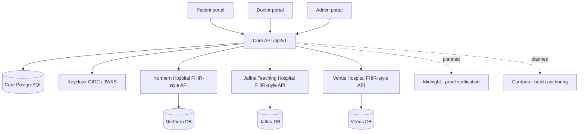

# LankaHealthChain

**Federated Healthcare Records · Patient Consent · Verifiable Integrity**

UniHack 2026 hackathon implementation | Apache-2.0 | **synthetic medical data only**.

> **STATUS: Foundation + local-consent demo implementation (not production-ready).**
> Core NestJS endpoints, hospital simulators, versioned Prisma SQL migrations and
> React dashboards are included. Live database migrations, browser E2E, Cardano
> Preprod transactions, Midnight Compact contract deployment, and real ZK proofs
> have NOT yet been executed or completed. Never enter real patient information.

## System architecture



Three hospital simulators are **mocked institutional integrations**, not actual
connections to the named hospitals. Their clinical resources are stored separately;
the Core stores registry, identity mappings, consent, record references, randomized
integrity commitments, and audit logs. Core never opens hospital SQL connections.

## Prerequisites

- Node.js **>= 22.22.3** (Prisma 7 documented requirement)
- Corepack + pnpm 10, Git
- Docker Desktop + Compose (Windows users: WSL2 + Docker Desktop)
- 8GB+ RAM recommended for the full local toolchain

## Step 1 - Configure env

```bash
cp .env.example .env
```

Replace **all** `CHANGE_*` values and the three `HOSPITAL_*_TOKEN_SECRET` values with unique random values.
For the four DB connection strings, the passwords must match the associated `LHC_*_DB_PASSWORD` settings.
For this local test, use shell-safe, URL-safe passwords; otherwise URL-encode special characters in connection strings.

```bash
# Linux/WSL2; loads environment in the terminal (do not commit .env)
set -a
. ./.env
set +a
```

`CONSENT_MODE=local-demo` is only for development, never production. `NODE_ENV=production`
with this mode is blocked by Core API startup. Set `OIDC_ISSUER=http://localhost:8080/realms/lankahealthchain`.

## Step 2 - Start PostgreSQL and Keycloak

```bash
docker compose --env-file .env -f infrastructure/docker/compose.yml up -d
docker compose -f infrastructure/docker/compose.yml ps
```

The postgres initialization creates **four logical databases and four distinct database roles**.
Hospital credential `lhc_northern` cannot query the Venus database. Database creation
scripts run only for an empty PostgreSQL volume. Demo Keycloak identity credentials are
**hardcoded in the imported development realm** and must never be exposed publicly.

## Step 3 - Install workspace dependencies

```bash
corepack enable
corepack prepare pnpm@10.18.0 --activate
pnpm install
```

## Step 4 - Build the shared packages + generate Prisma clients

```bash
pnpm --filter @lhc/shared build
pnpm --filter @lhc/database build
pnpm --filter @lhc/hospital-database build
```

`build` for each database package performs `prisma generate` before compiling its
TypeScript client wrapper. Run it again after schema changes. See
[`docs/database/migrations.md`](docs/database/migrations.md).

## Step 5 - Apply SQL migrations to all four databases

```bash
pnpm db:migrate
pnpm db:seed
```

Migration sequence:

- Core `202611220001_init/migration.sql`
- Core `202611220002_constraints/migration.sql`
- Hospital `202611220001_init/migration.sql` **three independent executions**.

`pnpm db:seed` inserts the synthetic Arun demo (4 FHIR-style resources in 3 hospitals)
and central pseudonymous identity/record-index entries. No Cardano transaction is issued.

## Step 6 - Start services (seven terminals)

**Terminal A** — Core API:

```bash
pnpm --filter @lhc/api dev
```

**Terminals B/C/D** — Hospital simulators (each terminal inherits `.env`):

```bash
# B
HOSPITAL_CODE=northern HOSPITAL_TOKEN_SECRET="$HOSPITAL_NORTHERN_TOKEN_SECRET" HOSPITAL_DATABASE_URL="$HOSPITAL_NORTHERN_DATABASE_URL" pnpm --filter @lhc/hospital-simulator dev
# C
HOSPITAL_CODE=jaffna HOSPITAL_TOKEN_SECRET="$HOSPITAL_JAFFNA_TOKEN_SECRET" HOSPITAL_DATABASE_URL="$HOSPITAL_JAFFNA_DATABASE_URL" pnpm --filter @lhc/hospital-simulator dev
# D
HOSPITAL_CODE=venus HOSPITAL_TOKEN_SECRET="$HOSPITAL_VENUS_TOKEN_SECRET" HOSPITAL_DATABASE_URL="$HOSPITAL_VENUS_DATABASE_URL" pnpm --filter @lhc/hospital-simulator dev
```

**Terminal E** — Web portals; start each in a separate terminal (or use parallel launch):

```bash
pnpm --filter @lhc/patient-portal dev  # http://localhost:5173
pnpm --filter @lhc/doctor-portal dev   # http://localhost:5174
pnpm --filter @lhc/admin-portal dev    # http://localhost:5175
```

API health: `http://localhost:3000/api/v1/health`.
Swagger documentation: `http://localhost:3000/api/docs`.
Keycloak: `http://localhost:8080` (local only).

### Local-only demo users

| Role | Keycloak username | Password |
| --- | --- | --- |
| Synthetic patient | `patient.arun` | `DemoPatient123!` |
| Verified doctor | `doctor.venus` | `DemoDoctor123!` |
| Network admin | `admin.network` | `DemoAdmin123!` |

**Never use these credentials or their realm import on a public server.**
They are synthetic local authentication fixtures.

## Step 7 - Run the demo

1. Doctor portal: submit an access request for synthetic patient `b1111111-1111-4111-8111-111111111111`.
2. Patient portal: open pending requests, approve scoped consent.
3. Doctor portal: refresh, then open approved records from the three simulated hospitals.
4. Patient portal: revoke the consent. Doctor tries another retrieval; the API should deny access.
5. Modify a hospital's synthetic record in its PostgreSQL DB, without re-registering the commitment. Expected result: local integrity mismatch.

> IMPORTANT: The approval is **LOCAL_DEMO_NOT_MIDNIGHT** and integrity is
> `LOCAL_MATCH` with Cardano `PENDING`. The interface does not claim a live ZK proof
> or blockchain transaction. Those are separate planned integration milestones.

## Step 8 - Run automated tests

```bash
pnpm test
pnpm --filter @lhc/api typecheck
pnpm --filter @lhc/hospital-simulator typecheck
pnpm --filter @lhc/patient-portal typecheck
```

Without dependencies and a running DB, only the dependency-free unit tests are runnable.
For real integration tests use a disposable PostgreSQL database and Keycloak instance.
See [`docs/testing/status.md`](docs/testing/status.md).

## API routes

All browser-accessible endpoints use `/api/v1`. Authenticated requests require a
validated Keycloak access token (issuer, audience, algorithm, key, expiration).

| Verb | Path | Purpose |
| --- | --- | --- |
| GET | `/api/v1/health` | Status |
| GET | `/api/v1/hospitals` | Approved demo facility directory |
| POST | `/api/v1/access-requests` | Doctor requests scoped access |
| GET | `/api/v1/access-requests/mine` | Doctor request list |
| GET | `/api/v1/patients/me/access-requests` | Patient pending approvals |
| POST | `/api/v1/access-requests/:id/approve` | Patient approves (demo only) |
| POST | `/api/v1/access-requests/:id/reject` | Patient rejects |
| POST | `/api/v1/consents/:id/revoke` | Patient revokes |
| GET | `/api/v1/access-requests/:id/records` | Doctor reads authorized FHIR data |
| GET | `/api/v1/patients/me/timeline` | Patient record index |
| GET | `/api/v1/patients/me/consents` | Patient consent history |
| GET | `/api/v1/audit/me` | Patient access audit |

Internal hospital APIs use `/internal/v1/records/:externalId` and are NOT public APIs.
They accept short-lived, narrowly scoped HMAC service tokens. **Production requires
mTLS/asymmetric inter-service identity, stronger patient identity mapping, replay
protections, secure secrets storage and audited network boundaries.**

## Repository layout

```text
apps/
  api/                  NestJS modular Core API
  hospital-simulator/   NestJS site-owned API instance, one per hospital DB
  patient-portal/       React + Vite patient UI
  doctor-portal/        React + Vite clinician UI
  admin-portal/         React + Vite administrator UI
packages/
  database/             Core Prisma models, migrations, seed
  hospital-database/    Hospital Prisma models, migrations
  shared/               Crypto, consent policies, FHIR guards, service tokens
  web/                  Auth client, shared UI, responsive theme
contracts/              Integration contracts and engineering placeholders
infrastructure/
  postgres/             Separate DB role bootstrap
  docker/               Local PostgreSQL and Keycloak
  keycloak/             DEV ONLY realm import
tests/unit/             Executable dependency-free tests
docs/                   Architecture ADRs, migrations, privacy, testing
```

## Roadmap and non-goals

- **Current increment:** Repository, SQL migrations, demo seeds, role-bound request flow,
  local scoped consent, local integrity verification, basic portal UIs, unit tests.
- **Next increment:** Real database integration tests, transaction-bound audit/outbox,
  stronger service boundaries, real FHIR R4 profile validation and HAPI FHIR adapter.
- **Blockchain increment:** Real Compact contract / Midnight proof verifier, Cardano
  Preprod batch anchor writer/verification, testnet evidence, key handling.
- **Production:** External audit, hospital approval, privacy/legal review, HA,
  production-grade IAM/PKI, key rotation, backups, encrypted identity mapping,
  deployment and performance tests.

See [security notes](SECURITY.md), [architecture decisions](docs/architecture/adr/), and
[testing status](docs/testing/status.md). No clinical safety or regulatory claims are made.
