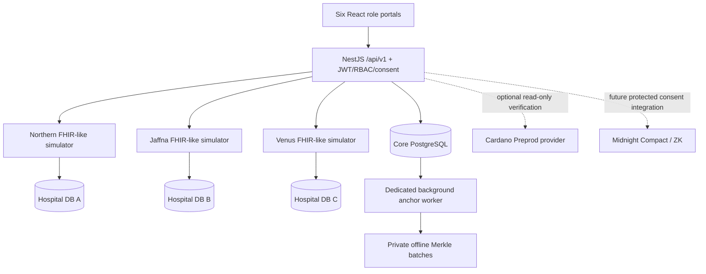

# LankaHealthChain — v0.11.0 (Synthetic Demonstration)

> **Clinical-use warning:** This is an open-source *research/hackathon prototype*. Only synthetic patient records are permitted. It is not a clinically validated system. Patient consent currently uses `local-demo`, **not Midnight ZK**. Cardano Merkle commitments have been verified offline, **not with a confirmed live Preprod transaction**. Do not connect real hospital systems or real patient information.

## Purpose

A privacy-conscious cross-hospital record-exchange **prototype** built with modular NestJS `/api/v1`, three independently credentialed hospital PostgreSQL services, six React portals, a background Cardano batch-preparation worker, and a version-controlled OpenAPI 3.1 contract.

### Key design decisions

- **Backend first:** NestJS modular monolith; avoid unnecessary microservice orchestration for an unmeasured workload.
- **Hospital isolation:** Northern, Jaffna and Venus are *synthetic simulators*, each with a separate database and scoped internal service tokens. Core API reads records only via their Hospital APIs.
- **Trust boundaries:** JWT/OIDC identity, role/tenant/consent authorization in the backend, append-only audit, record integrity commitments, no patient data on public chains.
- **Async work:** PostgreSQL outbox, dedicated worker, bounded polling, advisory lock, retry/backoff, dead-letter and health monitoring.
- **Configurable deployments:** Core/portal/hospital ports, CORS allowlist, JWKS/issuer, internal/public URLs and Cardano metadata provider are supplied by environment variables. No application-runtime `localhost` or provider endpoint fallback.
- **Minimum UI:** Six simple, responsive light-theme portals. No browser offline caching of patient data.

## Architecture



## Repository layout

| Path | Responsibility |
|---|---|
| `apps/api/` | Versioned NestJS API, authentication, permissions, institutional governance |
| `apps/hospital-simulator/` | One reusable isolated Hospital API, deployed three times |
| `apps/worker/` | Background Merkle preparation, recovery and operational health |
| `apps/{patient,doctor,admin,hospital-admin,security-auditor,researcher}-portal/` | Six minimal React applications |
| `packages/database/` | Core Prisma schema, migrations, identity/consent/audit/worker tables |
| `packages/hospital-database/` | Reusable hospital schema and migration history |
| `packages/shared/` | FHIR validation, cryptography, policy, URL/config validation |
| `packages/web/` | Shared browser auth and UI |
| `contracts/` | Cardano offline scripts and draft Midnight Compact contract |
| `infrastructure/` | Development-only Docker Compose, PostgreSQL bootstrap, Keycloak *template* |
| `scripts/qa/` | Offline checks, API contract, Postman generator and live-stack scripts |
| `docs/api/` | 40-operation OpenAPI spec, authorization matrix and Postman collection |

## Quick start — local synthetic environment only

Requirements: **Node.js >=22.22.3**, Docker Desktop/Engine with Compose, Corepack/pnpm 10, and Internet access for first dependency/image download.

```bash
# Run at repository root; never commit the generated .env or private/ directory.
node scripts/setup-local.mjs

# Boot all services and run the source-provided migrations/seed process.
docker compose --env-file .env \
  -f infrastructure/docker/compose.yml \
  -f infrastructure/docker/compose.app.yml up -d --build

docker compose --env-file .env \
  -f infrastructure/docker/compose.yml \
  -f infrastructure/docker/compose.app.yml ps
```

`setup-local.mjs` creates unique passwords and service-token secrets and generates a private Keycloak realm with **six environment-based redirect origins and six random synthetic demo user passwords**. To regenerate the private Keycloak import file after authorized portal configuration changes, run `node scripts/generate-keycloak-realm.mjs` using the existing `.env`. Do **not** publish this generated realm. For production, replace the development Keycloak instance, authorization proof layer and synthetic user model entirely.

**Important:** Existing `.env` files from v0.10.0 are not overwritten. Create a fresh local demo configuration or manually add the new required variables, then regenerate the realm. Host/Container endpoint variables are intentionally separate.

For native/manual processes, export variables from `.env` and supply each Hospital's own `PORT`, `HOSPITAL_DATABASE_URL` and `HOSPITAL_TOKEN_SECRET` independently. The easiest reproducible local run is Docker Compose.

See **[தமிழில் முழு Setup Guide](docs/setup-tamil.md)** for commands, URLs and failure diagnostics.

## API contract

All functional routes use **`/api/v1`**. Local URL is configured through `VITE_API_URL`; Swagger (development only) is `/api/docs`. Machine-readable contract: [`docs/api/openapi.json`](docs/api/openapi.json) / [`openapi.yaml`](docs/api/openapi.yaml). Test Postman collection: [`docs/api/lankahealthchain.postman_collection.json`](docs/api/lankahealthchain.postman_collection.json). Postman contains no access tokens, passwords or PHI.

Authentication uses Keycloak OIDC with audience `lhc-api`; the browser PKCE public client receives no backend secret. `Idempotency-Key` is supported for doctor access requests; paginated endpoints are available for large histories. Backend rechecks doctor/hospital status and current consent before releasing requested records.

## Tests and checks

```bash
node scripts/qa/config-audit.mjs
node --experimental-strip-types --test tests/unit/*.test.mjs
node --experimental-strip-types --test tests/integration/*.test.mjs
node scripts/qa/verify-openapi.mjs
node scripts/qa/generate-postman.mjs

# Requires a real supported toolchain and installed packages:
corepack enable
corepack prepare pnpm@10.18.0 --activate
pnpm install
pnpm build
```

**Live Docker smoke / isolation tests** (synthetic demo only; tests write synthetic data):

```bash
set -a; . ./.env; set +a
node scripts/qa/live-smoke.mjs
LHC_ACCEPT_SYNTHETIC_WRITE=YES node scripts/qa/live-flow.mjs
LHC_ACCEPT_SYNTHETIC_WRITE=YES node scripts/qa/live-governance.mjs
```

The source contains **15 Core SQL migration files and 3 reusable Hospital migration files**. They must be **executed and checked on PostgreSQL** before marking database integration complete. GitHub CI workflows provide additional executable checks but their successful status is not implied by source review.

## Deployment & security restrictions

`infrastructure/docker/*` is **development-only** (`Keycloak start-dev`, Vite dev servers, localhost-bound public ports). The proof-server profile is optional. `.env`, secrets, signed keys, private Merkle proofs and generated Keycloak imports must not enter a public repository. Production HTTP must use TLS and tested external identity infrastructure. For actual healthcare use, clinical conformance, encrypted patient identity mapping, hospital agreements, approvals, PDPA compliance review, external security assessment and operational readiness are still required.

**Verification limitations:** The current environment cannot install the npm toolchain or run Docker, PostgreSQL migrations, browser E2E, Cardano Preprod submissions or Midnight proof generation. The offline QA results do not imply any of those are complete.

Full status: [`docs/testing/RELEASE_VERIFICATION_0.11.md`](docs/testing/RELEASE_VERIFICATION_0.11.md), [deployment checklist](docs/testing/deployment-checklist.md), [implementation plan](docs/architecture/submission-hardening-plan.md).

License: Apache 2.0. See `SECURITY.md` and `CONTRIBUTING.md`.
