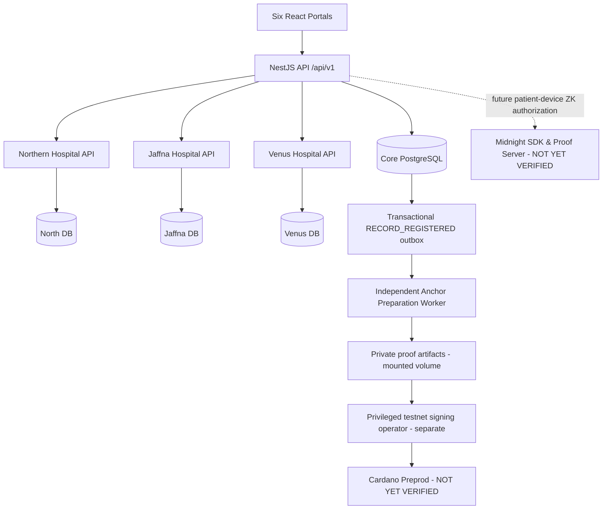

# LankaHealthChain background-processing architecture (v0.10)

## Architecture decision (ADR)

**Chosen:** Core NestJS modular monolith, three isolated hospital API services,
a PostgreSQL-backed outbox, and a dedicated long-running Cardano offline
preparation process. A Kafka / RabbitMQ / Redis microservice fleet adds
operational burden without evidence that it is needed for the synthetic MVP.
The hospital API instances already have independent DB credentials.

## Safe processing sequence

1. Hospital record registration commits an index and `RECORD_REGISTERED` outbox
   event within a core database transaction.
2. The dedicated worker polls for available, unpublished, non-dead-letter events.
3. A transaction-scoped PostgreSQL advisory lock prevents cooperating replicas
   from selecting the same batch.
4. Missing record references are dead-lettered with only a generic error code.
5. The worker builds a complete Merkle batch, stores proofs and marks events
   published **atomically** in PostgreSQL.
6. After commit it reconstructs private proof artifacts. Pending batches are
   enumerated in bounded, keyset-paginated groups so large queues do not
   starve later roots. A crash between 5
   and 6 is safe because the next iteration recovers the files from PostgreSQL.
7. A separate privileged operator reviews, signs, submits and independently
   confirms a Preprod transaction. The background worker holds no signing key.
8. Only a confirmed, validated transaction can be recorded as on-chain evidence.

## Reliability & controls

- Poll interval `WORKER_POLL_MS` validated: 5,000–600,000 ms (default 15,000).
- Bounded backoff on failed cycles (up to five minutes).
- SIGTERM/SIGINT shut down after current cycle, with a Docker grace period.
- Core DB heartbeat includes last successful cycle and generic error code; no PHI.
- Network-admin-only monitoring endpoint does not reveal internal credentials.
- Worker can be restarted; job selection, advisory lock, unique record anchors,
  and proof recovery make re-processing safe within the intended model.
- The outbox is a **durable Postgres queue** for this stage, not a clinical
  event bus; all traffic remains synthetic demonstration data.
- Operator should inspect dead-letter entries; there is no automatic replay
  of invalid/missing indexes. Do not silently discard records.

## Service worker vs backend worker

A browser Service Worker caches assets or runs client-side event handling;
it must **not** store medical records offline in this prototype.
The new `backend/apps/worker` is a separate Node.js server-side process.

## Scale-out options

- Stateless API replicas behind TLS reverse proxy only after live E2E.
- Horizontal hospital API replicas per hospital with per-tenant DB isolation.
- More worker replicas remain serialized for batch selection by advisory locks.
  For higher throughput, later shard queue claims with lease-based `SKIP LOCKED`
  workers and add dedicated object storage; do not claim this today.
- Promote modules to microservices **only** when measured traffic/isolation
  requirements justify separate deploy cycles, operational ownership and SLOs.

## Not implemented / remaining gates

Prisma migration application and full Node/NestJS build, real Docker E2E,
Midnight Compact compilation and wallet-verified ZK proof, Cardano testnet
submission/confirmation, clinical validation and production security review.
