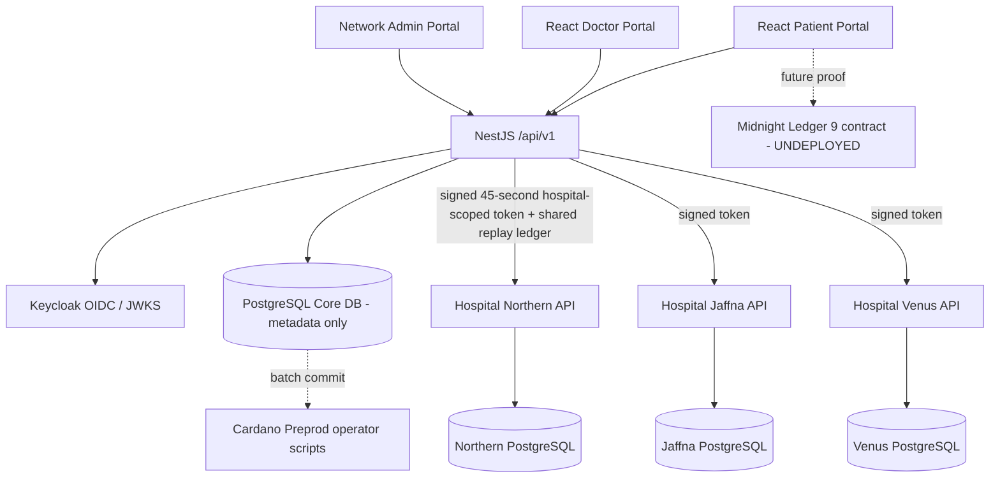

# LankaHealthChain System Design – Engineering Decision Record

**Status:** Development prototype, 22 November 2026. **Real hospitals are not integrated.**

## Logical architecture

The three hospital APIs and their data are synthetic simulator endpoints, not live hospital connections. At MVP scale the databases may reside on the same PostgreSQL process but use four distinct databases and four distinct login roles. In a real consortium each hospital would own its database, firewall and API adapter.

## Bounded contexts

| Domain | Responsibility | Ownership |
|---|---|---|
| Identity | JWT validation, OIDC role claims, patient/doctor mapping | Core; Keycloak owns authentication |
| Consent | Authenticated patient grants, limited types/purpose/expiry, revocation | Core DB for local-demo only |
| Record index | Record locator, source hospital, version, randomized commitment | Core DB |
| Clinical storage | FHIR payloads and their independent schema/migrations | Hospital DB per hospital |
| Audit | Events and outcomes; DB trigger blocks UPDATE/DELETE | Core DB; external signed log export and retention not implemented |
| Trust | Local proof validation, Cardano Merkle inclusion proof | Core and operator scripts |
| Midnight | Patient secret witness and ZK consent proof | Experimental Compact contract, not wired |

## Flow 1 – New medical record

1. Doctor authenticates with OIDC; Core requires `doctor` realm role, verified/active doctor, active institution and patient mapping at their hospital.
2. Core creates FHIR id if absent and inserts hospital-local `Patient` subject. It validates a restricted resource-type envelope.
3. Core sends short-lived signed **write** token and resource only to the authorized hospital API.
4. Hospital API checks token signature, expiry, action, hospital code, local patient, FHIR type/id/version and replay ID; stores its JSON in its own database. A duplicate id with different contents returns 409.
5. Core registers nonce-based cryptographic commitment and record locator. It does not centrally store the FHIR payload; result is marked `PENDING` Cardano anchor.

**Distributed failure limitation:** If Core DB commit fails after hospital save, a retry with same external FHIR id can reconcile, but a durable reconciler and outbox publisher are not yet implemented. Operators must audit orphan records.

## Flow 2 – Cross-hospital read

1. Doctor posts `/api/v1/access-requests` with patient UUID, purpose, requested resource types and bounded expiry.
2. Only the authenticated patient can approve/reject pending requests. In `local-demo` mode, approval creates an off-chain scoped Consent. This is **not a Midnight proof**.
3. Core checks doctor authorization, request status, consent version/current state, scope and expiry before each source request.
4. Hospital API returns only matching FHIR record when presented with valid **read** token.
5. Core checks source resource type, id, hospital-local patient subject and randomized commitment; mismatches fail closed. It checks current consent again before returning a record.
6. Revocation blocks new record retrievals but cannot claw back already-downloaded copies.

## Trust boundary and tenancy

- Core API must not open a direct SQL connection to Hospital A/B/C databases.
- Hospitals must not share DB credentials; Postgres `CONNECT` is revoked from `PUBLIC`.
- Hospital replicas now use atomic uniqueness in their own PostgreSQL `UsedServiceToken` table to reject replays across instances. Expired entries are periodically pruned. Production also requires service mTLS, availability tests and abuse metrics; DB failover behavior remains unverified.
- Avoid patient name, NIC/PHN, raw hashes, medical data, nonces, request scope, or consent identities on any public blockchain.
- Core can be horizontally scaled with a shared database, but distributed locks, audit infrastructure, encrypted identity-mapping and transaction queue requirements must be implemented before scaling.

## Scalability trajectory

**Increment 1 (hackathon):** NestJS modular monolith + three HTTP hospital simulators + 4 DBs; versioned migrations and deterministic synthetic fixtures.

**Increment 2:** Transactional outbox consumers, Redis request replay cache, asynchronous anchoring worker, S3-compatible encrypted document store, migration rollouts, persistent audit sinks, structured telemetry, retries with idempotency and dead-letter queues.

**Increment 3:** Standard HAPI FHIR profile validation and national facility/provider registry mapping, federated trust governance, HA Postgres / PITR, TLS/mTLS and Kubernetes only after load testing and service ownership are proven.

This design makes **no throughput, compliance or production readiness promise**. Do not extrapolate from the small local protocol tests.
